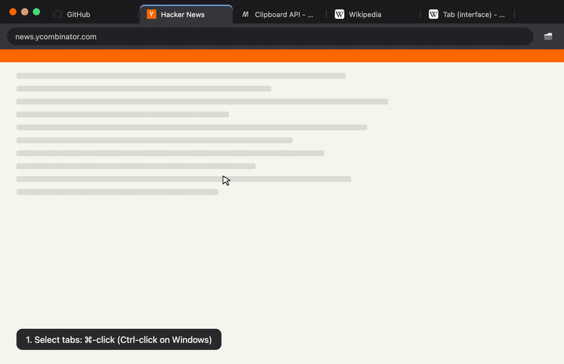

# TabBrain

A Chrome extension that copies the links of the tabs you select.
It can also save all your open tabs as a list you can search later.
Everything stays on your computer.



## Copy links of selected tabs

1. Select tabs in the tab strip. Hold ⌘ (Ctrl on Windows and Linux) and click each tab. To select a row of tabs, hold ⇧ and click.
2. Click the TabBrain icon.
3. Click the copy button. It shows how many links it copies, for example **Copy 3 links**.

You can copy the links in three formats:

```text
URLs          https://example.com
Markdown      - [Example Domain](https://example.com)
Title + URL   Example Domain
              https://example.com
```

TabBrain remembers the format you chose last time.
In the popup, press Enter or ⌘C (Ctrl+C) to copy.
Press 1, 2, or 3 to change the format.

If you select only one tab, TabBrain copies that tab.
To copy every tab in the window, click **Copy all tabs in this window** below the copy button.
The link shows the number of tabs, and it appears only when the window has more tabs than you selected.

## Save tabs for later

**Save all tabs** stores every open tab, in all windows, as one session.
Your tabs stay open.
TabBrain labels each tab by its site, for example Dev / Code, News, or Shopping.
Sites that TabBrain does not know go to Other.
X and Reddit tabs also get a topic from the page text, for example "X - Trading".
TabBrain skips links you already saved.

Open the dashboard to search your sessions, filter by category or tag, and reopen tabs.
You can also export your sessions to a backup file and import that file on another computer.

## Optional AI tags

TabBrain can ask Google Gemini for a few tags and a one-line summary of each tab when you save.
This needs your own Gemini API key, which is a free password-like code from Google.
AI tags stay off until you add a key.

1. Get a key at [aistudio.google.com/apikey](https://aistudio.google.com/apikey).
2. Click the gear icon in the TabBrain popup.
3. Paste the key, click **Test API Key**, and then click **Save Settings**.

TabBrain uses the `gemini-3.5-flash-lite` model.
Google changes its free usage limits from time to time.
You can see your limits at [aistudio.google.com/rate-limit](https://aistudio.google.com/rate-limit).

## Install

TabBrain is not in the Chrome Web Store yet, so you install it from this GitHub page.
During install, Chrome warns that TabBrain can "read and change all your data on all websites" and "read your browsing history".
The [Privacy](#privacy) section explains why.

1. Click **Code > Download ZIP** on this page. Unzip the file to get a folder named `tabbrain-main`.
2. Move that folder to a place where it can stay. Chrome loads TabBrain from this folder, so do not delete it later.
3. Open `chrome://extensions` in Chrome.
4. Turn on **Developer mode** in the top-right corner.
5. Click **Load unpacked** and select the `tabbrain-main` folder. Do not select the `src` folder inside it.
6. Click the puzzle icon in the toolbar and pin TabBrain.

To update, replace the folder with the new version.
Then click the reload icon on the TabBrain card in `chrome://extensions`.

To remove TabBrain, click **Remove** on its card in `chrome://extensions`.
This also deletes your saved sessions, so export a backup first.

## Privacy

TabBrain has no account, no server, and no analytics.
Your sessions and settings stay on your computer, inside Chrome.

- **Copying links** reads only the titles and links of your tabs. Nothing leaves your computer.
- **Saving tabs** reads up to 1,500 characters of text from each page. TabBrain uses this text to add tags. The category comes from the site address. This text is why Chrome shows the "read and change all your data" warning. TabBrain does not change pages.
- **Tab titles and links** are why Chrome shows the "read your browsing history" warning. TabBrain reads them only when you open the popup or save.
- **AI tags** are the only feature that sends page data out of your computer. When you save with a Gemini key, TabBrain sends data to Google. For each new tab, it sends the title, the link, and the first 800 characters of text. Google's [Gemini API terms](https://ai.google.dev/gemini-api/terms) let Google use that data to improve its products. Do not turn on AI tags if your tabs show private information.
- **Backup files** contain titles, links, tags, AI summaries, and up to 500 characters of page text for each tab. Keep these files private.
- **Site icons** in the dashboard load from each site, the same way they do in Chrome's tab strip.

## Good to know

- Your saved sessions exist only in this Chrome profile.
- TabBrain keeps your 50 newest sessions and deletes older ones.
- TabBrain saves only web pages (`http` and `https`). It skips pages like `chrome://settings` and local files.
- I build and test TabBrain in Chrome only.

## Development

There is no build step.
Edit the files in `src/`, then click reload on the TabBrain card in `chrome://extensions`.

```text
manifest.json          Extension config (Manifest V3)
src/background.js      Saves sessions, imports and exports
src/categorizer.js     Site categories and keyword tags
src/ai-tagger.js       Gemini API calls
src/content.js         Reads page text when you save
src/link-format.js     Link formats for copying
src/popup.*            Toolbar popup
src/dashboard.*        Session dashboard
src/settings.*         API key settings
```

## License

[MIT](LICENSE)
